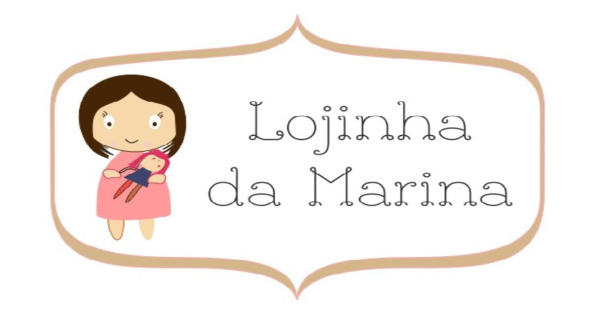
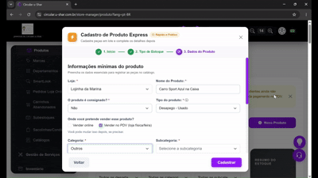
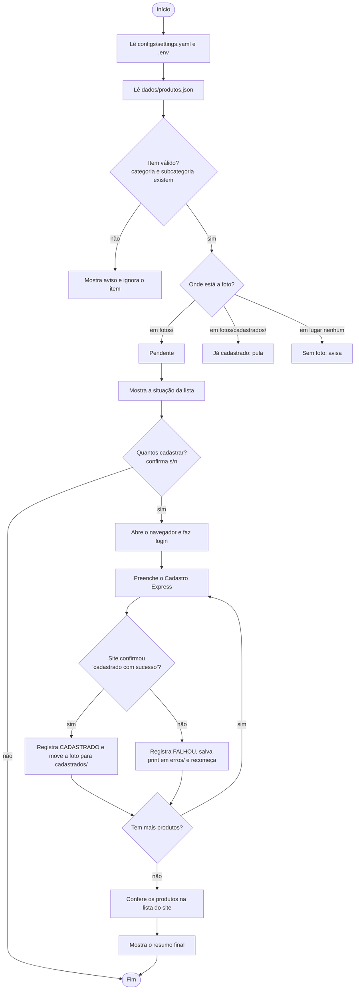

# automacao-lojinha 🛍️

**Cadastro automático de produtos em lote na plataforma Circular u-Shar**

Fotos + um arquivo JSON entram, produtos cadastrados saem: o robô preenche o
cadastro sozinho, confere cada etapa e registra tudo.

  
   <em>O robô preenchendo o Cadastro Express sozinho</em>

---

## Sumário

- [O problema](#o-problema)
- [A solução](#a-solução)
- [Como funciona](#como-funciona)
- [Sobre o desenvolvimento](#sobre-o-desenvolvimento)

---

## O problema

A **[Lojinha da Marina](https://lojinhadamarina.com.br/#lojinha-da-marina)** é um projeto voluntário que dá a crianças em vulnerabilidade social a
experiência de visitar uma loja, muitas vezes pela primeira vez. Tudo na lojinha é doado: as crianças
participam de oficinas, ganham a moeda social **"Amor Real"** e usam essa moeda para fazer suas compras.

Com cerca de 1.500 crianças atendidas, chegam milhares de doações: roupas, calçados, livros e muitos
brinquedos. Cada uma precisa ser cadastrada à mão no sistema da loja, num formulário com **nome,
categoria, subcategoria, preço, quantidade, tipo e foto**. São mais de 10 cliques por peça.

Feito à mão, isso levaria dias de trabalho repetitivo, com muito espaço para erro: categoria trocada,
foto esquecida ou o mesmo produto cadastrado duas vezes.

Conheça o projeto social: **[lojinhadamarina.com.br](https://lojinhadamarina.com.br/#lojinha-da-marina)**

## A solução

Um robô em Python que:

1. 📋 **lê uma lista** (`produtos.json`) com o nome, a categoria e a foto de cada peça;
2. ✅ **valida tudo antes** de abrir o navegador (categoria existe? a foto está na pasta?);
3. 🤖 **preenche o Cadastro Express** com o Playwright, como uma pessoa faria;
4. 🔍 **confere cada etapa** e só considera o produto cadastrado quando o site confirma;
5. 📁 **move a foto** para `cadastrados/` e **registra** o resultado num relatório.

Rodar de novo é seguro: o que já foi cadastrado é pulado automaticamente.

## Como funciona

---

## Sobre o desenvolvimento

Projeto desenvolvido por **Maria Eduarda** com o apoio do **Claude (Anthropic)**.
Identifiquei o problema, defini as regras do cadastro, testei cada versão na loja real,
reportei os erros e decidi as mudanças.

### Como o projeto evoluiu

| Etapa | O que mudou |
|---|---|
| **1. Cadastro à mão** | Os primeiros produtos foram cadastrados manualmente, para entender cada campo do formulário |
| **2. Tentativa com OCR e pastas** | Testei o **Tesseract** no Python para ler o texto das fotos e separava as fotos à mão, em pastas por categoria e subcategoria. O OCR só funcionava em itens com texto (capas de livro, caixas de brinquedo), e separar tudo à mão continuava lento |
| **3. Mudança de lógica: IA + JSON** | Em vez de ler texto, passei a usar IA para **identificar o item em cada foto** e devolver um arquivo JSON com o nome, a categoria e a subcategoria. As pastas por categoria deixaram de ser necessárias |
| **4. Robô de cadastro** | Um script com o Playwright lê esse JSON e preenche o cadastro sozinho |
| **5. Projeto organizado** | O código foi separado em módulos, ganhou validação, testes e passou a ser versionado com Git |

> **Por que mudei a lógica?** O Tesseract lê letras, mas a maioria das doações (roupas, calçados,
> brinquedos sem caixa) não tem texto nenhum. Para dar nome e categoria a esses itens, era preciso
> reconhecer o que aparece na foto, e foi aí que a IA entrou como solução para essa barreira.

### Desafios do caminho

Problemas que só apareceram quando o código encontrou o site de verdade:

- **Listas que carregam aos poucos:** a lista de subcategorias chega do servidor depois de alguns
  instantes, e clicar pela posição escolhia a opção errada. O robô passou a clicar **pelo texto** e a
  conferir o campo depois.
- **Foto que não subia:** havia mais de um campo de upload na página. O robô passou a usar o campo de
  dentro do formulário e a esperar a confirmação de que a foto carregou.
- **Produtos duplicados:** depois de várias rodadas, ficava difícil saber o que já tinha entrado. A
  pasta `cadastrados/` virou o "estado" do projeto, então rodar de novo nunca duplica nada.
